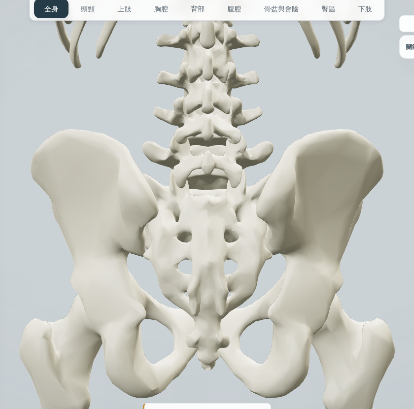
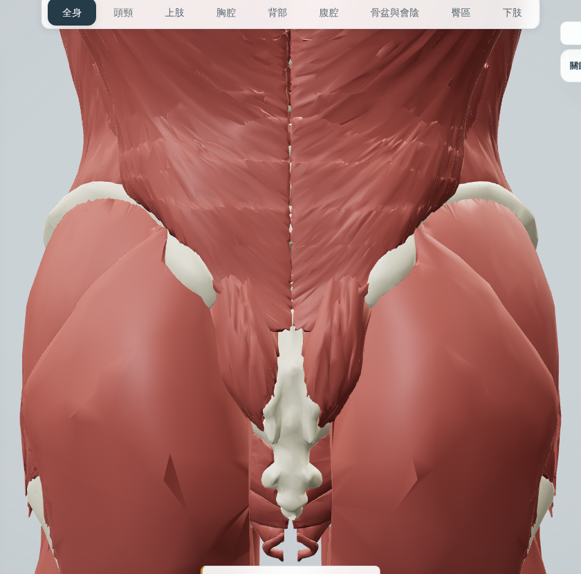
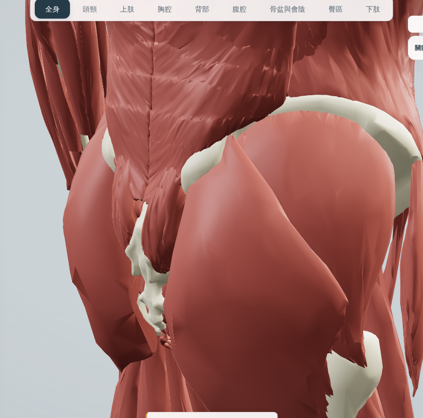
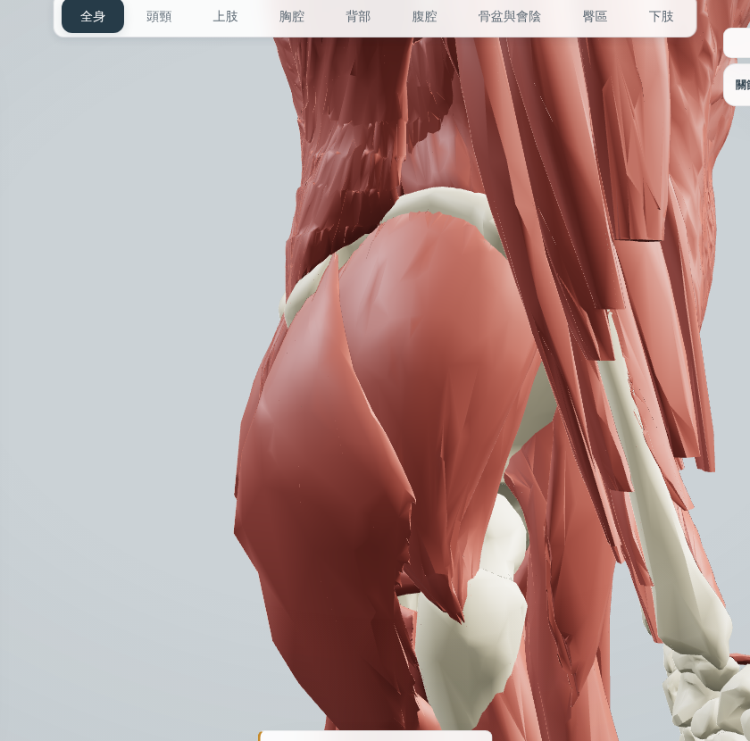
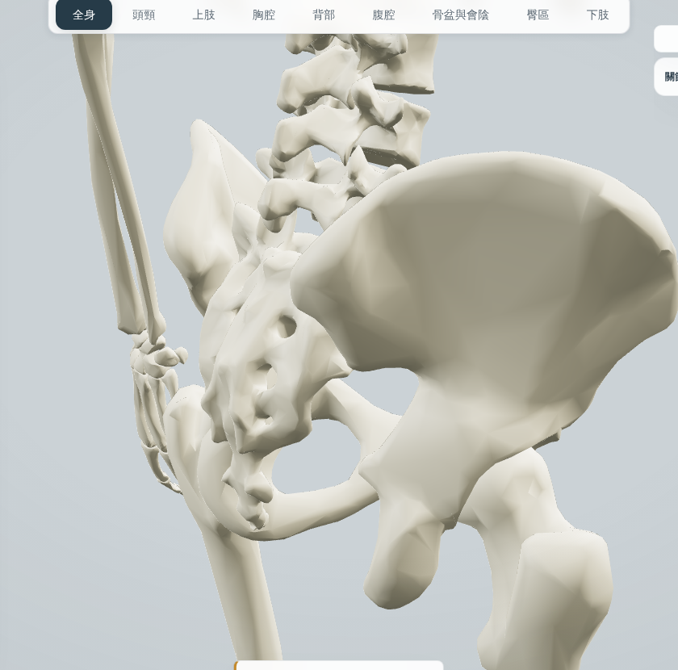
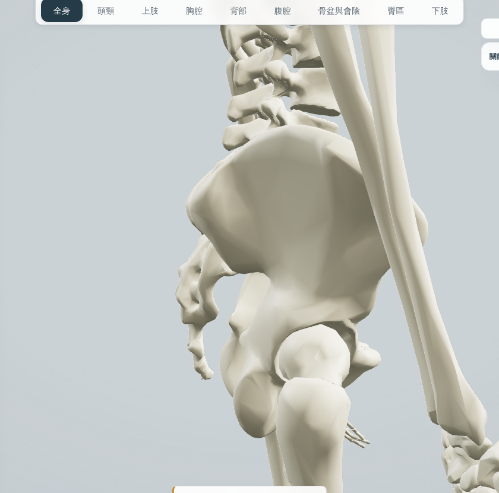
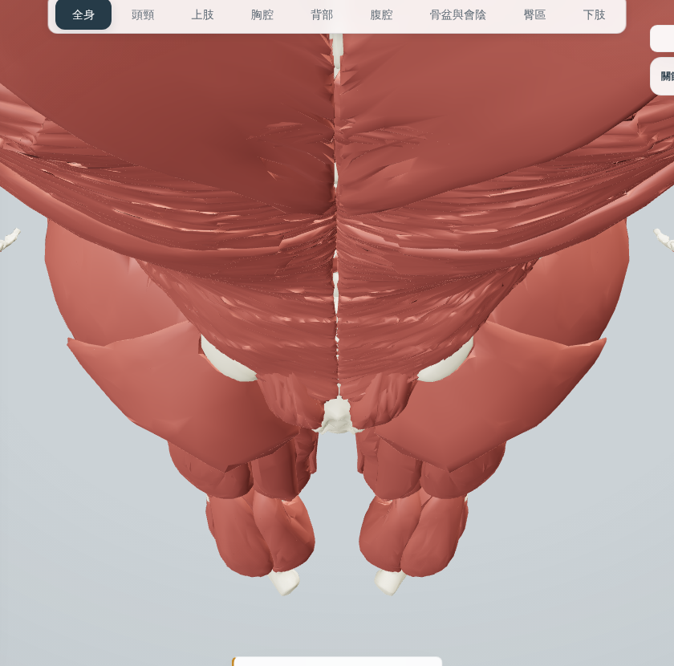

# 臀區上方米色橢圓：調查報告（只調查，沒有改模型）

**需人工審核。** 查明結果：這兩個米色橢圓是**真的骨頭（左右髖骨後部）**，不是碎片、殘留或浮空的網格；它們出現是因為這一帶**沒有軟組織蓋住**。建議不要刪除，而是補上蓋住它的軟組織（見最後一節），等你決定。

## 怎麼查的
正式 build（`vite build` + 靜態伺服，軟體 GL，最新 main `08b6a2a`），只開骨骼與肌肉，從背面、斜後、側面、上方截圖；再在背面視角對下背與臀區點選一個格子（121 點），記錄資訊卡標題；另用射線從背面對右側 x 20–150 mm、y 900–1060 mm 的格點求「最先碰到哪個網格」（`scripts/browser/glute-ellipse.cjs`、一次性的射線腳本）。

## 截圖
| 只開骨骼（背面） | 骨骼＋肌肉（背面） |
| --- | --- |
|  |  |
| 骨骼＋肌肉（斜後） | 骨骼＋肌肉（側面） |
|  |  |
| 只開骨骼（斜後） | 只開骨骼（側面）與上方 |
|  | 　 |

## 點選結果（背面視角，骨骼＋肌肉）
- 橢圓位置的點選回報 **Left coxal bone（左髖骨）**、**Right coxal bone（右髖骨）**，各 3 個點；網格名稱是 **Left hip bone（FJ3288）**、**Right hip bone（FJ3152）**，系統為骨骼，來源 BodyParts3D。
- 周圍回報：外側與下方是右／左臀大肌、臀中肌；內側是左／右腰髂肋肌；中間是薦骨與第四、第五腰椎。沒有任何韌帶、碎片或示意網格被點到。
- 資料裡另有 `HRAF-bone-Left/Right-hip-bone`（女性骨盆用），只在選女性時出現，與男性預設畫面無關。

## 射線量測（右側，毫米）
- 從背面最先碰到右髖骨（骨面外露）的格點：**x −40 到 −60、y 970 到 1000**（薦髂關節與後上棘旁，內側），以及沿**髂嵴上緣** y 約 1030、x −90 到 −130 的一條帶（髂嵴本身）。
- 其餘格點最先碰到的是右臀大肌、臀中肌、背闊肌、髂脛束、腰髂肋肌。
- 也就是說原本報告（#180）寫的「x 44–120、y 940–990」現在大部分已被臀大肌蓋住（#180 重做臀大肌後），留下的外露骨面主要在內側 x 40–60 mm 與髂嵴上緣。

## 判斷
- **真結構。** 是髂骨後部（後上棘附近、臀後線以上）。形狀是橢圓，是因為內側被腰髂肋肌與多裂肌框住，外側與下方被臀中肌與臀大肌框住，上緣是髂嵴。
- **不是碎片或殘留**：只有一個網格（髖骨），沒有多餘的小塊、沒有浮空、沒有與骨頭重疊的獨立網格。
- **為什麼看起來怪：** 真實解剖這一帶有臀大肌的起點（髂骨後部、臀後線以後）與豎脊肌腱膜、胸腰筋膜下緣蓋住，骨頭不會外露。模型的臀大肌上緣停在臀後線以下、胸腰筋膜示意模型也沒有延伸到髂嵴與後上棘，所以骨面露了出來。

## 建議處理（等你決定，這份報告沒有改任何模型）
1. **不要刪除髖骨網格**（它是真的骨頭，也是其他結構的附著參照）。
2. **補軟組織蓋住它**，兩個做法可擇一或並用：
   - 延伸臀大肌上緣到臀後線與後上棘一帶，並讓內側起點接到薦骨與薦結節韌帶（真實起點），屬於臀區肌肉修正；
   - 讓胸腰筋膜（後層）下緣延伸到髂嵴與後上棘（#201／#202 的胸腰筋膜形狀決定後一併處理）。
3. 若只想暫時不顯眼：不建議用上色或隱藏處理，因為它是真骨頭。

## 限制
- 截圖是軟體 GL；射線量測只算右側。左側由點選結果確認（左髖骨），沒有另算數值。
- 沒有拍女性模式的畫面（女性骨盆是另一組網格）。
